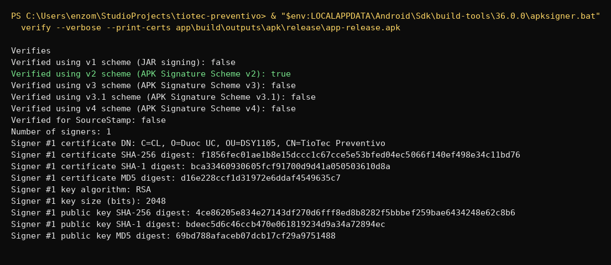
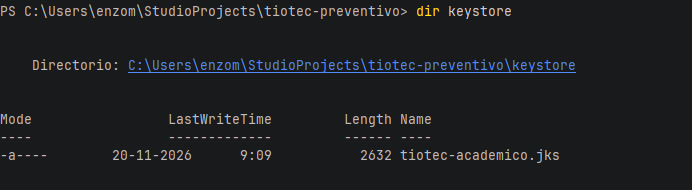

# TíoTec Preventivo

App Android de **prevención digital** para personas no especialistas. Guía una evaluación sobre hábitos de seguridad de un dispositivo, muestra el **nivel de riesgo por categoría** con recomendaciones priorizadas y ayuda a darles seguimiento con un **checklist, recordatorios e historial**. Las evaluaciones, resultados, acciones e historial se guardan **en el teléfono**; las **solicitudes de asistencia** y los **dispositivos** se sincronizan con dos **microservicios propios** (Spring Boot + MySQL), y la pantalla **Comunidad** muestra datos de una **API pública externa** consumida con Retrofit.

Proyecto en dupla para la asignatura **DSY1105 · Desarrollo de Aplicaciones Móviles** (Evaluaciones Parciales 2, 4 y 5), basado en el caso *TíoTec Preventivo*.

> ⚠️ Todos los perfiles, dispositivos y solicitudes son **ficticios**. La app **orienta según las respuestas**: no revisa, no escanea ni accede a la configuración real del teléfono, y no pide datos personales ni sensibles.

- **Tablero Trello:** <https://trello.com/b/TVOC98PJ>
- **Pull requests:** <https://github.com/Ezz442/tiotec-preventivo/pulls?q=is%3Apr>

---

## 1. Problema y usuarios

Muchas personas pierden fotos, documentos o el acceso a sus cuentas porque no tienen copias de seguridad, no actualizan sus equipos o no saben cómo recuperar una cuenta. La información técnica disponible suele ser difícil de entender.

**Usuario:** una persona sin formación técnica que quiere saber qué tan protegido está un dispositivo y qué hacer primero. Usa un **alias ficticio** y registra **dispositivos de prueba**.

**Qué resuelve la app:** un cuestionario breve en cuatro áreas (**respaldos, actualizaciones, autenticación y recuperación de cuentas**), un resultado explicado en lenguaje simple y un plan de acciones con fecha de revisión.

## 2. Integrantes

| Integrante | GitHub | Tareas principales |
|---|---|---|
| Enzo Morales | [@Ezz442](https://github.com/Ezz442) | TT-02 repositorio · TT-04 modelo local · TT-06 catálogo · TT-07 Room · TT-08 DataStore · TT-10 reglas de riesgo · TT-12 resultados · TT-14 historial · TT-16 recordatorios · TT-18 cámara · TT-21 verificación · TT-22 README · TT-28 dispositivos-service · TT-30 API externa · TT-31 pruebas unitarias · TT-32 APK firmado y README |
| Gerard Zambrano | [@gjjzc](https://github.com/gjjzc) | TT-03 diseño y navegación · TT-05 base Compose/MVVM · TT-09 perfil y dispositivos · TT-11 evaluación guiada · TT-13 checklist · TT-15 contenidos · TT-17 solicitudes · TT-19 galería · TT-27 diseño · TT-28 solicitudes-service · TT-29 conexión de la app a los microservicios |

Cada tarea se desarrolló en su rama y la revisó el otro integrante antes de integrarla (ver sección 9).

## 3. Funciones implementadas

| Función | Qué hace | Pantalla | Tarea · PR |
|---|---|---|---|
| Perfil ficticio | Alias (2 a 30 caracteres) y nivel de experiencia, con errores por campo | Perfil | TT-09 · [#10](https://github.com/Ezz442/tiotec-preventivo/pull/10) |
| Preferencias | Tema claro/oscuro/sistema y avisos, guardados con DataStore | Perfil → Ajustes | TT-08 · [#9](https://github.com/Ezz442/tiotec-preventivo/pull/9) |
| Dispositivos | Crear, editar y eliminar con confirmación; nombre no repetido; archivado si tiene evaluaciones | Inicio → Mis dispositivos | TT-09 · [#10](https://github.com/Ezz442/tiotec-preventivo/pull/10) |
| Foto con **cámara** | Activity Result API (`TakePicture`) + FileProvider; reemplazar y quitar | Tarjeta del dispositivo | TT-18 · [#19](https://github.com/Ezz442/tiotec-preventivo/pull/19) |
| Imagen de **galería** | Selector de fotos (`PickVisualMedia`) con copia local de la imagen | Tarjeta del dispositivo | TT-19 · [#20](https://github.com/Ezz442/tiotec-preventivo/pull/20) |
| Evaluación guiada | 12 preguntas, progreso, validación por pregunta, revisión antes de finalizar, confirmación de salida | Evaluar dispositivo | TT-11 · [#12](https://github.com/Ezz442/tiotec-preventivo/pull/12) |
| Reglas de riesgo | Puntaje por categoría, prácticas clave, nivel bajo/medio/alto y nivel global | — (lógica) | TT-10 · [#11](https://github.com/Ezz442/tiotec-preventivo/pull/11) |
| Resultados | Nivel con **ícono + texto + color**, explicación, recomendaciones priorizadas y la respuesta que las activó | Resultados | TT-12 · [#13](https://github.com/Ezz442/tiotec-preventivo/pull/13) |
| Checklist de acciones | Pendientes/Completadas, cambio de estado persistente, contador animado | Mis acciones | TT-13 · [#14](https://github.com/Ezz442/tiotec-preventivo/pull/14) |
| Historial | Evaluaciones por fecha y dispositivo, filtros, detalle con las respuestas guardadas | Inicio → Historial | TT-14 · [#15](https://github.com/Ezz442/tiotec-preventivo/pull/15) |
| Contenidos educativos | Filtros por categoría y lectura; también se abren desde las recomendaciones | Aprende | TT-15 · [#16](https://github.com/Ezz442/tiotec-preventivo/pull/16) |
| Recordatorios | Fecha y hora validadas, **notificación local** con WorkManager, permiso en Android 13+, abre Mis acciones al tocar | Mis acciones | TT-16 · [#17](https://github.com/Ezz442/tiotec-preventivo/pull/17) |
| Asistencia simulada | Solicitudes con categoría obligatoria, estados con confirmación e historial | Perfil → Solicitudes | TT-17 · [#18](https://github.com/Ezz442/tiotec-preventivo/pull/18) |
| Catálogo local | Preguntas, recomendaciones y contenidos viven en el código de la app y funcionan aunque los servicios estén apagados | Evaluar, Aprende | TT-06 · [#7](https://github.com/Ezz442/tiotec-preventivo/pull/7) |
| **Microservicios propios** | Solicitudes y dispositivos con **CRUD completo** contra Spring Boot + MySQL; Room guarda una copia local con los mismos ids y avisa si el servicio no responde | Perfil → Solicitudes, Inicio → Mis dispositivos | TT-28 y TT-29 · [#28](https://github.com/Ezz442/tiotec-preventivo/pull/28) |
| **API externa** | Textos de JSONPlaceholder (`GET /posts`) con Retrofit; carga, error con *Reintentar* y vacío; no usa Room ni los microservicios | Aprende → Consejos de la comunidad | TT-30 · [PR](https://github.com/Ezz442/tiotec-preventivo/pulls?q=is%3Apr+TT-30) |
| Pruebas unitarias | JUnit 4 + MockK + coroutines-test; cobertura de la lógica cercana al 90 % (sección 6) | — | TT-31 · [PR](https://github.com/Ezz442/tiotec-preventivo/pulls?q=is%3Apr+TT-31) |
| APK firmado | Release con R8 y firma digital con `.jks` (sección 7) | — | TT-32 |

### Fuera del alcance o pendiente

Para no declarar como implementado algo que es solo diseño:

- **Alcance EP2 y EP4:** en EP2 la API REST se retiró y todo era local (Room, DataStore, cámara y galería; ver `docs/TT-04-modelo-local.md`). En EP4 se incorporaron los **microservicios propios** (TT-28 y TT-29) y la **API externa** (TT-30). Perfil, evaluaciones, resultados, acciones, recordatorios, fotos y preferencias **siguen siendo solo locales**: no viajan a ningún servicio.
- **Escribir exige servicio:** crear, editar, cambiar estado o eliminar solicitudes y dispositivos requiere que el microservicio responda; sin él se muestra el error y no se guarda nada local. Leer funciona siempre desde Room.
- **Diseñado en TT-03 pero no implementado así:** pantalla de bienvenida del primer uso; "última evaluación" y botón *Evaluar dispositivo* directo en Inicio (se evalúa desde Mis dispositivos); pantalla separada de recordatorios y recordatorio de *próxima evaluación* (los recordatorios se programan desde cada acción). El detalle está en la sección final de `docs/TT-03-diseno-navegacion.md`.
- **Estado de las tareas:** el avance de cada una está en el tablero de Trello.

## 4. Tecnologías y arquitectura

| Tema | Uso en el proyecto |
|---|---|
| Lenguaje | Kotlin 2.2.10 |
| UI | Jetpack Compose (BOM 2026.02.01) y **Material Design 3**, con esquema de color claro y oscuro |
| Navegación | Navigation Compose 2.9.7, rutas con argumentos y grafo anidado |
| Adaptación | `WindowSizeClass`: `NavigationBar` en Compact y `PermanentNavigationDrawer` en Medium/Expanded |
| Arquitectura | **MVVM**: Composables → ViewModel (`StateFlow` + `UiState`) → Repositorio → Room / DataStore / archivos |
| Estado | `MutableStateFlow` privado, `StateFlow` público y `collectAsState()` en la pantalla |
| Persistencia | **Room 2.8.5** (SQLite, transacciones, esquema exportado en `app/schemas`) y **DataStore Preferences 1.2.1** |
| Recursos nativos | Cámara (`TakePicture` + FileProvider), galería (`PickVisualMedia`), notificaciones (WorkManager 2.10.1 + `POST_NOTIFICATIONS`) |
| Red | Retrofit 3.0.0 + Gson + OkHttp (tiempos de espera de 10 s), corrutinas y errores traducidos a mensajes para el usuario (`ErrorRemoto`) |
| Backend | Dos microservicios **Spring Boot 3.5** (Java 17+) con **MySQL 8** (H2 para pruebas y respaldo), carpeta `backend/` |
| Pruebas | JUnit 4, **MockK 1.14**, kotlinx-coroutines-test y AndroidX Test (Room en emulador); cobertura con JaCoCo de Android Gradle Plugin |
| Entrega | APK release con **R8** (minificación) y firma con `.jks` |

```
app/src/main/java/cl/duoc/tiotecpreventivo/
├── data/            catálogo local, entidades y DAOs de Room, DataStore, imágenes, AppContainer
│   └── remote/      Retrofit: ConfigRed, ServiciosRemotos, APIs, DTOs, mapeadores y ErrorRemoto
├── domain/          reglas puras sin Android: riesgo, resultados, historial, validación de recordatorios
├── repository/      acceso a datos que usan los ViewModels (los *Sincronizado* hablan con los microservicios)
├── viewmodel/       un ViewModel + UiState + Factory por pantalla
├── notificaciones/  canal, aviso y WorkManager
└── ui/              navegación, pantallas, componentes y tema

backend/
├── solicitudes-service/    Spring Boot, puerto 8081, MySQL tiotec_solicitudes
└── dispositivos-service/   Spring Boot, puerto 8082, MySQL tiotec_dispositivos
```

Ningún Composable accede a Room ni a la red directamente: los ViewModels reciben los repositorios desde `AppContainer`, que se crea en `TioTecApplication`. **El servicio es la fuente de verdad y Room es la copia local** (ver `docs/TT-29-conexion-microservicios.md`).

## 5. Endpoints utilizados

### Microservicios propios (los consume la app, TT-29)

Se ejecutan en el computador del equipo. Documentación completa de rutas, cuerpos y errores en [`backend/solicitudes-service/README.md`](backend/solicitudes-service/README.md) y [`backend/dispositivos-service/README.md`](backend/dispositivos-service/README.md).

**solicitudes-service** · puerto **8081** · base `tiotec_solicitudes`

| Método | Ruta | Uso en la app |
|---|---|---|
| GET | `/api/solicitudes` | Lista (Perfil → Solicitudes) |
| GET | `/api/solicitudes/{id}` | Detalle con historial |
| GET | `/api/solicitudes/{id}/historial` | Historial de estados (disponible en el servicio) |
| POST | `/api/solicitudes` | Nueva solicitud |
| PUT | `/api/solicitudes/{id}` | Editar (disponible en el servicio; solo mientras está `PENDIENTE`) |
| PATCH | `/api/solicitudes/{id}/estado` | Cambiar estado |
| DELETE | `/api/solicitudes/{id}` | Eliminar |

**dispositivos-service** · puerto **8082** · base `tiotec_dispositivos`

| Método | Ruta | Uso en la app |
|---|---|---|
| GET | `/api/dispositivos` | Lista (Inicio → Mis dispositivos) |
| GET | `/api/dispositivos/{id}` | Detalle (disponible en el servicio) |
| POST | `/api/dispositivos` | Agregar |
| PUT | `/api/dispositivos/{id}` | Editar nombre y sistema operativo |
| PATCH | `/api/dispositivos/{id}/archivado` | Archivar (dispositivos con evaluaciones) |
| DELETE | `/api/dispositivos/{id}` | Eliminar (sin evaluaciones) |

### API externa (TT-30)

| Método | URL | Uso en la app |
|---|---|---|
| GET | `https://jsonplaceholder.typicode.com/posts?_limit=10` | Aprende → Consejos de la comunidad |
| GET | `https://jsonplaceholder.typicode.com/posts/{id}` | Definido en `PostsApi`; la pantalla aún no lo usa |

JSONPlaceholder es una API pública de demostración: devuelve texto de relleno en latín y no guarda nada. Solo se **lee**, en memoria; no usa Room ni los microservicios, y si falla solo falla esa pantalla. Detalle y diferencias con un microservicio propio en [`docs/TT-30-API-EXTERNA.md`](docs/TT-30-API-EXTERNA.md).

## 6. Requisitos y pasos para ejecutar

**Requisitos**

- Android Studio reciente con soporte para Android Gradle Plugin 9.4 (incluye el JDK necesario).
- Android SDK con la plataforma de `targetSdk` 37 (Android Studio la ofrece al sincronizar).
- Emulador o teléfono con **Android 7.0 (API 24)** o superior. Para probar el permiso de notificaciones, usar **Android 13 (API 33)** o superior.
- Para los microservicios: **JDK 17 o superior**, **Maven 3.9** y **MySQL 8** (o el perfil H2, sin MySQL).
- Internet para la primera sincronización de Gradle y para la pantalla Comunidad.

**1. Clonar**

```bash
git clone https://github.com/Ezz442/tiotec-preventivo.git
```

**2. Levantar los microservicios** (dos terminales; la clave de MySQL se pasa por variable de entorno y **nunca** se escribe en el repositorio)

```powershell
$env:DB_USER = "root"
$env:DB_PASSWORD = "<tu clave de MySQL>"

cd backend\solicitudes-service
mvn spring-boot:run          # http://localhost:8081

# en otra terminal, con las mismas variables:
cd backend\dispositivos-service
mvn spring-boot:run          # http://localhost:8082
```

Las bases se crean solas. Sin MySQL: agregar `-Dspring-boot.run.profiles=h2`.

**3. Conectar el emulador con los servicios.** La app usa `http://localhost:8081/` y `http://localhost:8082/` (`ConfigRed.kt`); para que el emulador llegue al computador se redirigen los puertos. Hay que repetirlo cada vez que se reinicia el emulador:

```powershell
adb reverse tcp:8081 tcp:8081
adb reverse tcp:8082 tcp:8082
```

`adb` está en `%LOCALAPPDATA%\Android\Sdk\platform-tools`.

**4. Ejecutar la app.** Abrir la carpeta en Android Studio, esperar la sincronización de Gradle y ejecutar la configuración **app**. Primer uso sugerido: Perfil → crear perfil → Inicio → Mis dispositivos → agregar un dispositivo → *Evaluar dispositivo*; Perfil → Solicitudes → nueva solicitud; Aprende → Consejos de la comunidad.

Si los servicios no están encendidos la app sigue funcionando con lo guardado y muestra un aviso de falta de conexión; la pantalla Comunidad solo necesita internet.

**Pruebas**

```powershell
# Pruebas en la JVM (sin emulador)
.\gradlew.bat :app:testDebugUnitTest
# Reporte de cobertura (abrir app\build\reports\coverage\test\debug\index.html)
.\gradlew.bat createDebugUnitTestCoverageReport
# Pruebas de Room y DataStore en el emulador (encendido)
.\gradlew.bat :app:connectedDebugAndroidTest
# Microservicios (H2 en memoria, no necesitan MySQL)
cd backend; mvn test
```

**Cobertura de la lógica (TT-31, JaCoCo, 300 pruebas JVM sin fallos)**

| Paquete | Instrucciones cubiertas |
|---|---|
| `viewmodel` | 86 % |
| `repository` | 88 % |
| `domain` | 95 % |
| `data.remote` | 90 % |

Sobre las 2.131 líneas de esos paquetes quedan 213 sin cubrir (cerca del 90 %). El total del proyecto es menor porque incluye pantallas Compose y clases generadas por Room, que no son lógica de negocio. Los microservicios tienen sus propias pruebas (9 en solicitudes y 10 en dispositivos). El resultado de EP2 sigue documentado en `docs/TT-21-verificacion.md`.

## 7. APK firmado

El APK **release** se compila con **R8** (minificación) y se firma con una llave académica (`.jks`) creada solo para este proyecto. Las contraseñas **no están en el repositorio**: se leen de `keystore.properties`, que está en `.gitignore`; se entrega un ejemplo en `keystore.properties.example`.

| Archivo | Ubicación |
|---|---|
| APK firmado | `entrega/TioTec-Preventivo-release.apk` |
| Llave de firma | `keystore/tiotec-academico.jks` |
| Configuración | `signingConfigs` en `app/build.gradle.kts` y `keystore.properties.example` |
| Reglas de R8 | `app/src/main/keepRules/rules.keep` (conservan los DTO de Gson y las interfaces de Retrofit) |

**Generar el APK**

```powershell
copy keystore.properties.example keystore.properties   # completar las contraseñas
.\gradlew.bat assembleRelease
# resultado: app\build\outputs\apk\release\app-release.apk
```

Sin `keystore.properties` el proyecto compila igual (debug) y el release queda sin firmar.

**Verificar la firma**

```powershell
& "$env:LOCALAPPDATA\Android\Sdk\build-tools\<versión>\apksigner.bat" verify --verbose --print-certs app\build\outputs\apk\release\app-release.apk
```

**Instalar y probar contra los microservicios** (emulador con los servicios encendidos y `adb reverse`):

```powershell
adb uninstall cl.duoc.tiotecpreventivo
adb install app\build\outputs\apk\release\app-release.apk
```

Una instalación debug previa se firmó con otra llave, por eso hay que desinstalarla primero. En un teléfono físico los servicios del computador no son accesibles con `localhost`: para probar allí habría que usar la IP del computador en `ConfigRed.kt`.

**Capturas**

| APK firmado y verificación | Llave `.jks` |
|---|---|
|  |  |

## 8. Relación con los indicadores de la rúbrica EP2

| Indicador | Qué se demuestra | Dónde verlo en la app | Pruebas | Evidencia |
|---|---|---|---|---|
| **IE 2.1.1** · Diseño visual y navegación | Material 3, tema claro/oscuro, riesgo con ícono + texto, NavigationBar o Drawer según el tamaño | Inicio, Resultados, Ajustes; rotar o usar tablet | Previews de cada pantalla | `docs/TT-03-diseno-navegacion.md`, `docs/TT-03-bocetos.html`, PR #3, #5, #6 |
| **IE 2.1.2** · Formularios validados | Errores por campo con ícono y mensaje, validación en el ViewModel, confirmaciones | Perfil, Dispositivos, Evaluación, Recordatorios, Solicitudes | `PerfilViewModelTest`, `DispositivosViewModelTest`, `EvaluacionViewModelTest`, `RecordatorioViewModelTest`, `ValidadorRecordatorioTest`, `SolicitudesViewModelTest` | PR #10, #12, #17, #18 |
| **IE 2.2.1** · Lógica y gestión de estado | ViewModel + StateFlow, reglas de riesgo puras, transiciones de acciones y solicitudes | Evaluación → Resultados → Mis acciones | `ReglasRiesgoTest`, `ResultadoEvaluacionMapperTest`, `AccionesViewModelTest`, `HistorialViewModelTest` | `docs/TT-10-reglas-riesgo.md`, `docs/TT-12-resultados-recomendaciones.md`, PR #11, #13, #14 |
| **IE 2.2.2** · Animaciones y retroalimentación | ⚠️ **Parcial:** contador animado (`AnimatedContent`), respuestas con `AnimatedVisibility`, Snackbars y carga solo durante operaciones reales | Mis acciones, detalle de resultado | — | PR #14, #15; se amplía en TT-25 |
| **IE 2.3.1** · Almacenamiento local | Room con transacciones, archivado, historial sin sobrescribir, DataStore e imágenes en almacenamiento privado | Historial, Ajustes, fotos tras cerrar y abrir | `RepositoriosRoomTest`, `HistorialRoomTest`, `ResultadoRoomTest`, `ImagenesReaperturaTest`, `PreferenciasRepositoryTest` | `docs/TT-07-room-persistencia.md`, `docs/TT-08-preferencias-datastore.md`, `docs/TT-14-historial.md`, `docs/TT-21-verificacion.md` |
| **IE 2.3.2** · Repositorio y documentación | Ramas por tarea, PR con revisión cruzada, Trello, README y documentos por tarea | GitHub y Trello | Script de copia limpia | Este README, sección 9 |
| **IE 2.4.1** · Recursos nativos | **Cámara**, **galería** y **notificaciones locales**, con cancelación, denegación y "no disponible" sin bloquear | Tarjeta del dispositivo, Mis acciones | `DispositivosFotoViewModelTest`, `DispositivosGaleriaViewModelTest`, `AlmacenImagenesLocalTest`, `GestorRecordatoriosTest` | `docs/TT-18-camara.md`, `docs/TT-16-recordatorios.md`, PR #17, #19, #20 |

Las capturas y videos de cada tarea están adjuntos en su tarjeta de Trello y en la conversación de su PR.

## 9. Trazabilidad: PR, commits y defectos

### Pull requests

Cada PR lo revisó el integrante que no era autor antes del merge.

| PR | Tarea | Autor |
|---|---|---|
| [#1](https://github.com/Ezz442/tiotec-preventivo/pull/1) | TT-02 README inicial | Enzo |
| [#2](https://github.com/Ezz442/tiotec-preventivo/pull/2) | TT-02 acceso de Gerard al repositorio | Gerard |
| [#3](https://github.com/Ezz442/tiotec-preventivo/pull/3) | TT-03 diseño de pantallas y bocetos | Gerard |
| [#4](https://github.com/Ezz442/tiotec-preventivo/pull/4) | TT-04 modelo local | Enzo |
| [#5](https://github.com/Ezz442/tiotec-preventivo/pull/5) | TT-27 bocetos y navegación al alcance local | Gerard |
| [#6](https://github.com/Ezz442/tiotec-preventivo/pull/6) | TT-05 base Compose, Material 3 y MVVM | Gerard |
| [#7](https://github.com/Ezz442/tiotec-preventivo/pull/7) | TT-06 catálogo local y datos ficticios | Enzo |
| [#8](https://github.com/Ezz442/tiotec-preventivo/pull/8) | TT-07 CRUD y persistencia con Room | Enzo |
| [#9](https://github.com/Ezz442/tiotec-preventivo/pull/9) | TT-08 preferencias con DataStore | Enzo |
| [#10](https://github.com/Ezz442/tiotec-preventivo/pull/10) | TT-09 perfil y dispositivos | Gerard |
| [#11](https://github.com/Ezz442/tiotec-preventivo/pull/11) | TT-10 cuestionario y reglas de riesgo | Enzo |
| [#12](https://github.com/Ezz442/tiotec-preventivo/pull/12) | TT-11 evaluación guiada | Gerard |
| [#13](https://github.com/Ezz442/tiotec-preventivo/pull/13) | TT-12 resultados y recomendaciones | Enzo |
| [#14](https://github.com/Ezz442/tiotec-preventivo/pull/14) | TT-13 checklist de acciones | Gerard |
| [#15](https://github.com/Ezz442/tiotec-preventivo/pull/15) | TT-14 historial | Enzo |
| [#16](https://github.com/Ezz442/tiotec-preventivo/pull/16) | TT-15 contenidos educativos (+ pruebas de Enzo en la revisión) | Gerard |
| [#17](https://github.com/Ezz442/tiotec-preventivo/pull/17) | TT-16 recordatorios y notificaciones | Enzo |
| [#18](https://github.com/Ezz442/tiotec-preventivo/pull/18) | TT-17 solicitudes simuladas | Gerard |
| [#19](https://github.com/Ezz442/tiotec-preventivo/pull/19) | TT-18 cámara | Enzo |
| [#20](https://github.com/Ezz442/tiotec-preventivo/pull/20) | TT-19 galería | Gerard |
| [#21](https://github.com/Ezz442/tiotec-preventivo/pull/21) | TT-21 verificación | Enzo |
| [#28](https://github.com/Ezz442/tiotec-preventivo/pull/28) | TT-28 microservicios y TT-29 conexión de la app | Gerard |
| [TT-30](https://github.com/Ezz442/tiotec-preventivo/pulls?q=is%3Apr+TT-30) | API externa con Retrofit | Enzo |
| [TT-31](https://github.com/Ezz442/tiotec-preventivo/pulls?q=is%3Apr+TT-31) | Pruebas unitarias con MockK y cobertura | Enzo |

### Defectos encontrados en revisión y resueltos

No se usaron *issues* de GitHub: los defectos se registraron en la revisión del PR y en la tarjeta de Trello.

| Tarea | Defecto | Lo encontró | Corrección |
|---|---|---|---|
| TT-09 | Textos y botones superpuestos en carga/error/sin perfil; espacio de más bajo la barra | Enzo (revisión de código) | PR #10, commit "corregir superposicion y espacio superior en dispositivos" |
| TT-11 | Conflicto de merge por ramas mezcladas en distinto orden | GitHub | PR #12, merge de `main` en la rama |
| TT-14 | El filtro del historial mostraba el nombre antiguo al renombrar sin reevaluar | Gerard (prueba manual) | PR #15, commit "mostrar en el filtro el nombre actual del dispositivo" + prueba de regresión |
| TT-21 | El script de copia limpia fallaba en PowerShell 5.1 (tildes) y sin `local.properties` | Enzo (ejecución) | PR #21 |

### Commits técnicos de ambos

Historial completo en [commits](https://github.com/Ezz442/tiotec-preventivo/commits/main), o filtrado por autor: [Enzo](https://github.com/Ezz442/tiotec-preventivo/commits/main?author=Ezz442) · [Gerard](https://github.com/Ezz442/tiotec-preventivo/commits/main?author=gjjzc).

- **Enzo:** "TT-07: agregar DAO y base de datos con transacciones y regla de archivado" · "TT-10: reglas de riesgo por categoría y recomendaciones priorizadas" · "TT-16: mostrar la notificación local a la hora del recordatorio" · "TT-18: tomar la foto con TakePicture y mostrarla en la tarjeta".
- **Gerard:** "TT-09: implementar CRUD de dispositivos con validaciones y confirmacion" · "TT-11: implementar evaluacion guiada con revision y guardado en Room" · "TT-13: implementar checklist persistente y contador real en inicio" · "TT-19: seleccionar imágenes de galería para dispositivos".

## 10. Documentación por tarea

| Documento | Contenido |
|---|---|
| [`docs/TT-03-diseno-navegacion.md`](docs/TT-03-diseno-navegacion.md) · [`TT-03-bocetos.html`](docs/TT-03-bocetos.html) | Pantallas, navegación, estados, criterios visuales y estado de implementación |
| [`docs/TT-04-modelo-local.md`](docs/TT-04-modelo-local.md) | Modelo de datos local y cambios desde la versión con API |
| [`docs/TT-06-datos-ficticios.md`](docs/TT-06-datos-ficticios.md) | Catálogo de preguntas, recomendaciones y contenidos |
| [`docs/TT-07-room-persistencia.md`](docs/TT-07-room-persistencia.md) | Room, transacciones y archivado |
| [`docs/TT-08-preferencias-datastore.md`](docs/TT-08-preferencias-datastore.md) | Preferencias con DataStore |
| [`docs/TT-10-reglas-riesgo.md`](docs/TT-10-reglas-riesgo.md) | Puntajes, umbrales y prácticas clave |
| [`docs/TT-12-resultados-recomendaciones.md`](docs/TT-12-resultados-recomendaciones.md) | Pantalla de resultados |
| [`docs/TT-14-historial.md`](docs/TT-14-historial.md) | Historial sin sobrescribir |
| [`docs/TT-16-recordatorios.md`](docs/TT-16-recordatorios.md) | Recordatorios, permisos y WorkManager |
| [`docs/TT-18-camara.md`](docs/TT-18-camara.md) | Cámara, FileProvider y almacenamiento privado |
| [`docs/TT-21-verificacion.md`](docs/TT-21-verificacion.md) | Matriz de pruebas y resultados (EP2) |
| [`docs/TT-29-conexion-microservicios.md`](docs/TT-29-conexion-microservicios.md) | Conexión de la app con los microservicios, endpoints y errores |
| [`docs/TT-30-API-EXTERNA.md`](docs/TT-30-API-EXTERNA.md) | API externa, estructura y diferencias con un microservicio |
| [`backend/README.md`](backend/README.md) · [`solicitudes-service`](backend/solicitudes-service/README.md) · [`dispositivos-service`](backend/dispositivos-service/README.md) | Microservicios: ejecución, arquitectura y endpoints |

## 11. Flujo de trabajo

- `main` contiene siempre una versión que compila.
- Cada tarea se trabaja en una rama `feat/TT-XX-descripcion` o `fix/TT-XX-descripcion`.
- Los cambios se integran mediante Pull Request revisado por el otro integrante.
- Las tareas, criterios y evidencias se gestionan en Trello con el identificador TT-XX.
- No se suben `local.properties`, `keystore.properties`, contraseñas ni datos reales (`.gitignore`).

## 12. Estado

Funcionalidad de la app, microservicios, API externa, pruebas unitarias y APK firmado integrados en `main`. El avance y las evidencias de cada tarea están en el tablero de Trello.
