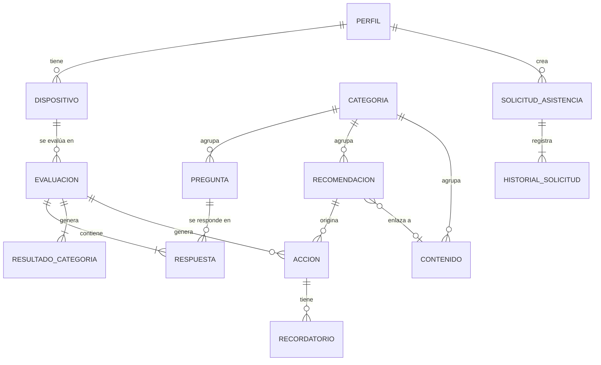

# TT-04 · Modelo de datos y contrato API

**Responsable:** Enzo Morales · **Revisión:** Gerard Zambrano
**Estado:** borrador para revisión. Se ajusta según TT-01 y los bocetos de TT-03 (`docs/TT-03-bocetos.html`).

> Todos los datos son ficticios. El modelo no guarda nombres reales, correos, teléfonos, ubicación ni datos sensibles.

---

## 1. Convenciones

| Tema | Regla |
|---|---|
| Formato | JSON, campos en `camelCase` |
| Identificadores | `id` tipo UUID (texto). Los objetos que crea el usuario (perfil, dispositivo, evaluación, acción, recordatorio, solicitud) generan su UUID **en la app**, así reintentar un envío no crea duplicados |
| Fechas | ISO 8601 en UTC: `"2026-10-15T18:00:00Z"`. Solo fecha: `"2026-10-22"` |
| Estados y tipos | Enums en MAYÚSCULAS: `RIESGO_ALTO`, `PENDIENTE` |
| URL base | `/api/v1` |
| Rol de demostración | Header `X-Rol: USUARIO`, `ADMINISTRADOR` o `REFERENTE_TECNICO`. Es solo para la demo, **no es autenticación real** |

---

## 2. Categorías preventivas (fijas)

| `codigo` | Nombre visible |
|---|---|
| `RESPALDOS` | Respaldos |
| `ACTUALIZACIONES` | Actualizaciones |
| `AUTENTICACION` | Autenticación |
| `RECUPERACION` | Recuperación de cuentas |

---

## 3. Modelo de datos



### 3.1 Perfil (ficticio)
| Campo | Tipo | Notas |
|---|---|---|
| `id` | UUID | |
| `alias` | texto (2–30) | Obligatorio. Ej.: "Usuario Demo" |
| `experienciaDigital` | enum | `PRINCIPIANTE`, `INTERMEDIO`, `AVANZADO` |
| `rolDemo` | enum | `USUARIO`, `ADMINISTRADOR`, `REFERENTE_TECNICO` |
| `creadoEn`, `actualizadoEn` | fecha-hora | |

### 3.2 Dispositivo (de prueba)
| Campo | Tipo | Notas |
|---|---|---|
| `id` | UUID | |
| `perfilId` | UUID | |
| `nombre` | texto (2–30) | Ej.: "Teléfono de prueba" |
| `sistemaOperativo` | enum | `ANDROID`, `IOS`, `WINDOWS`, `MACOS`, `OTRO` |
| `creadoEn`, `actualizadoEn` | fecha-hora | |

### 3.3 Categoría
`codigo` (enum de la sección 2), `nombre`, `descripcion`, `orden`.

### 3.4 Pregunta
| Campo | Tipo | Notas |
|---|---|---|
| `id` | UUID | |
| `categoria` | enum | |
| `texto` | texto | Ej.: "¿Tienes activada la verificación en dos pasos?" |
| `ayuda` | texto | Explicación breve bajo la pregunta |
| `opciones` | lista | Cada opción: `valor` (`SI`, `NO`, `NO_SE`), `etiqueta`, `puntaje` (0 = sin riesgo, 2 = riesgo alto) |
| `orden` | entero | |
| `version` | entero | Sube cada vez que el administrador la edita |
| `activa` | booleano | Desactivar en vez de borrar, para no romper el historial |
| `estadoRevision` | enum | Ver 3.11 |

### 3.5 Evaluación
| Campo | Tipo | Notas |
|---|---|---|
| `id` | UUID | Generado en la app |
| `perfilId`, `dispositivoId` | UUID | |
| `fecha` | fecha-hora | |
| `nivelGlobal` | enum | `RIESGO_BAJO`, `RIESGO_MEDIO`, `RIESGO_ALTO` (el peor nivel entre categorías) |
| `respuestas` | lista de 3.6 | |
| `resultados` | lista de 3.7 | |

Se guarda **solo al finalizar** (bocetos 04 y 15: si sale sin finalizar, no se guarda). Ver el detalle en el historial no crea una evaluación nueva.

### 3.6 Respuesta
| Campo | Tipo | Notas |
|---|---|---|
| `preguntaId` | UUID | |
| `preguntaVersion` | entero | |
| `textoPregunta` | texto | **Copia** del texto al momento de responder, para que el historial no cambie si el admin edita la pregunta |
| `valor` | enum | `SI`, `NO`, `NO_SE` |
| `puntaje` | entero | |

### 3.7 Resultado por categoría
`categoria`, `puntaje` (suma), `nivel` (`RIESGO_BAJO` / `MEDIO` / `ALTO`), `explicacion` (texto simple). Las reglas exactas de puntaje se definen en **TT-10**.

### 3.8 Recomendación (catálogo)
| Campo | Tipo | Notas |
|---|---|---|
| `id` | UUID | |
| `categoria` | enum | |
| `preguntaId` | UUID | Pregunta que la activa |
| `valoresQueActivan` | lista | Ej.: `["NO", "NO_SE"]` |
| `titulo` | texto | Ej.: "Activar verificación en dos pasos" |
| `descripcion` | texto | |
| `prioridad` | enum | `ALTA`, `MEDIA`, `BAJA` |
| `diasParaRevision` | entero | Para calcular la próxima revisión de la acción |
| `contenidoId` | UUID o null | Para el botón "Aprender cómo hacerlo" |
| `activa`, `estadoRevision` | | Igual que en 3.4 |

### 3.9 Acción (checklist del usuario)
| Campo | Tipo | Notas |
|---|---|---|
| `id` | UUID | Generado en la app |
| `evaluacionId`, `dispositivoId` | UUID | |
| `recomendacionId` | UUID | **Única por evaluación**: no se repite la misma acción en una evaluación |
| `titulo`, `descripcion` | texto | Copia de la recomendación |
| `prioridad` | enum | |
| `estado` | enum | `PENDIENTE`, `COMPLETADA` (puede volver a pendiente) |
| `fechaRevision` | fecha | |
| `completadaEn` | fecha-hora o null | |
| `actualizadoEn` | fecha-hora | |

### 3.10 Recordatorio
| Campo | Tipo | Notas |
|---|---|---|
| `id` | UUID | |
| `accionId` | UUID | |
| `titulo` | texto | |
| `fechaHora` | fecha-hora | |
| `estado` | enum | `PROGRAMADO`, `CANCELADO`, `ENVIADO` |

**Solo local.** La notificación la programa el teléfono, así que no pasa por la API.

### 3.11 Contenido educativo
| Campo | Tipo | Notas |
|---|---|---|
| `id` | UUID | |
| `categoria` | enum | |
| `titulo`, `resumen`, `cuerpo` | texto | Lenguaje simple, lectura breve |
| `estadoRevision` | enum | `BORRADOR`, `PENDIENTE_REVISION`, `CORRECCION_SOLICITADA`, `REVISADO` |
| `observacionRevision` | texto o null | Lo escribe el referente técnico |
| `publicado` | booleano | Solo se muestra al usuario si está `REVISADO` y publicado |
| `actualizadoEn` | fecha-hora | |

El mismo `estadoRevision` y `observacionRevision` aplican a preguntas y recomendaciones (boceto 12, "Revisar criterios de riesgo").

### 3.12 Solicitud de asistencia (simulada)
| Campo | Tipo | Notas |
|---|---|---|
| `id` | UUID | |
| `codigo` | texto | Ej.: `DEMO-001` |
| `perfilId` | UUID | |
| `categoria` | enum | |
| `estado` | enum | `PENDIENTE`, `EN_REVISION`, `RESUELTA`, `CANCELADA` |
| `creadaEn` | fecha-hora | |
| `historial` | lista | Cada cambio: `estado`, `fecha`, `nota` |

No guarda descripción libre, para evitar que se escriban datos personales.

---

## 4. Endpoints

### Perfil y dispositivos
| Método | Ruta | Uso |
|---|---|---|
| `PUT` | `/perfiles/{id}` | Crear o actualizar perfil |
| `GET` | `/perfiles/{id}` | Obtener perfil |
| `GET` | `/perfiles/{id}/dispositivos` | Listar dispositivos |
| `PUT` | `/dispositivos/{id}` | Crear o actualizar dispositivo |
| `DELETE` | `/dispositivos/{id}` | Eliminar dispositivo de prueba |

### Catálogo (cuestionario y contenidos)
| Método | Ruta | Uso |
|---|---|---|
| `GET` | `/categorias` | Las cuatro categorías |
| `GET` | `/preguntas?activa=true` | Cuestionario vigente |
| `GET` | `/recomendaciones?activa=true` | Recomendaciones vigentes |
| `GET` | `/contenidos?categoria=AUTENTICACION` | Contenidos publicados (filtro opcional) |
| `GET` | `/contenidos/{id}` | Detalle |

### Evaluaciones y acciones
| Método | Ruta | Uso |
|---|---|---|
| `PUT` | `/evaluaciones/{id}` | Guardar evaluación finalizada con respuestas y resultados |
| `GET` | `/evaluaciones?dispositivoId=...` | Historial, más reciente primero |
| `GET` | `/evaluaciones/{id}` | Detalle |
| `GET` | `/acciones?perfilId=...&estado=PENDIENTE` | Plan preventivo |
| `PUT` | `/acciones/{id}` | Crear o actualizar acción |
| `PATCH` | `/acciones/{id}` | Cambiar `estado` / `fechaRevision` |

### Asistencia simulada
| Método | Ruta | Uso |
|---|---|---|
| `POST` | `/solicitudes` | Crear (la API asigna `codigo`) |
| `GET` | `/solicitudes?perfilId=...` | Listar |
| `GET` | `/solicitudes/{id}` | Detalle con historial |
| `PATCH` | `/solicitudes/{id}/estado` | Cambio de estado de prueba |

### Administración (`X-Rol: ADMINISTRADOR`)
| Método | Ruta | Uso |
|---|---|---|
| `GET` | `/admin/contenidos` | Todos, incluso no publicados |
| `POST` / `PUT` | `/admin/contenidos[/{id}]` | Crear o editar → queda `PENDIENTE_REVISION` |
| `POST` / `PUT` | `/admin/preguntas[/{id}]` | Igual, sube `version` |
| `POST` / `PUT` | `/admin/recomendaciones[/{id}]` | Igual |
| `PATCH` | `/admin/{tipo}/{id}/activa` | Activar o desactivar (no se borra) |

### Revisión técnica (`X-Rol: REFERENTE_TECNICO`)
| Método | Ruta | Uso |
|---|---|---|
| `GET` | `/revision/pendientes` | Todo lo que está en `PENDIENTE_REVISION` |
| `PATCH` | `/revision/{tipo}/{id}` | Body: `{ "decision": "REVISADO" \| "CORRECCION_SOLICITADA", "observacion": "..." }` |

`{tipo}` = `contenidos`, `preguntas` o `recomendaciones`.

---

## 5. Ejemplos

**Guardar evaluación** · `PUT /api/v1/evaluaciones/8b1e...`
```json
{
  "id": "8b1e2c3d-0000-4000-8000-000000000001",
  "perfilId": "a1...",
  "dispositivoId": "d1...",
  "fecha": "2026-10-15T18:20:00Z",
  "nivelGlobal": "RIESGO_ALTO",
  "respuestas": [
    {
      "preguntaId": "p-aut-01",
      "preguntaVersion": 1,
      "textoPregunta": "¿Tienes activada la verificación en dos pasos?",
      "valor": "NO",
      "puntaje": 2
    }
  ],
  "resultados": [
    {
      "categoria": "AUTENTICACION",
      "puntaje": 4,
      "nivel": "RIESGO_ALTO",
      "explicacion": "No indicaste tener verificación en dos pasos."
    }
  ]
}
```
Respuesta: `201 Created` la primera vez, `200 OK` si ya existía (mismo `id` → no se duplica).

**Error**
```json
{
  "codigo": "VALIDACION",
  "mensaje": "El alias es obligatorio.",
  "campos": { "alias": "Escribe un alias para continuar." }
}
```

| HTTP | `codigo` | Cuándo |
|---|---|---|
| 400 | `VALIDACION` | Datos faltantes o inválidos |
| 403 | `ROL_NO_PERMITIDO` | `X-Rol` sin permiso |
| 404 | `NO_ENCONTRADO` | ID inexistente |
| 409 | `CONFLICTO` | Ej.: acción repetida en la misma evaluación |
| 500 | `ERROR_SERVIDOR` | Falla interna |

---

## 6. Qué se guarda en local y qué viene de la API

| Dato | Room (local) | API | Fuente de verdad |
|---|---|---|---|
| Perfil, dispositivos | ✅ | ✅ (sincroniza) | Local |
| Evaluaciones, respuestas, resultados | ✅ | ✅ (sincroniza) | Local |
| Acciones | ✅ | ✅ (sincroniza) | Local |
| Recordatorios | ✅ | ❌ | Local |
| Categorías, preguntas, recomendaciones | ✅ caché | ✅ | API |
| Contenidos educativos | ✅ caché de los ya vistos | ✅ | API |
| Solicitudes simuladas | ✅ | ✅ | API |

### Estrategia de sincronización
1. **Primero local.** Todo lo que crea el usuario se guarda en Room antes de llamar a la API. Si la API falla, no se pierde nada (boceto 14).
2. **Campo `estadoSync`** (solo en Room): `PENDIENTE` o `SINCRONIZADO`. Al reconectar, se envían los `PENDIENTE` con `PUT`.
3. **Sin duplicados.** El UUID se genera en la app y el `PUT` es idempotente: repetir el envío actualiza en vez de crear.
4. **Conflictos:** gana el registro con `actualizadoEn` más reciente.
5. **Catálogo:** al abrir la app se intenta `GET`. Si no hay red, se usa la caché y se indica "información guardada en el teléfono".
6. **Historial estable:** las respuestas guardan copia del texto de la pregunta, y el admin desactiva en vez de borrar.

---

## 7. Pendientes por confirmar

- [ ] Backend permitido por el docente (afecta TT-06, no este contrato).
- [ ] Reglas de puntaje y umbrales bajo/medio/alto → **TT-10**.
- [ ] Opciones finales de experiencia digital y sistema operativo.
- [ ] Si la publicación de contenido es automática al quedar `REVISADO` o requiere un paso del admin.
- [ ] Revisión y aprobación de Gerard Zambrano.
