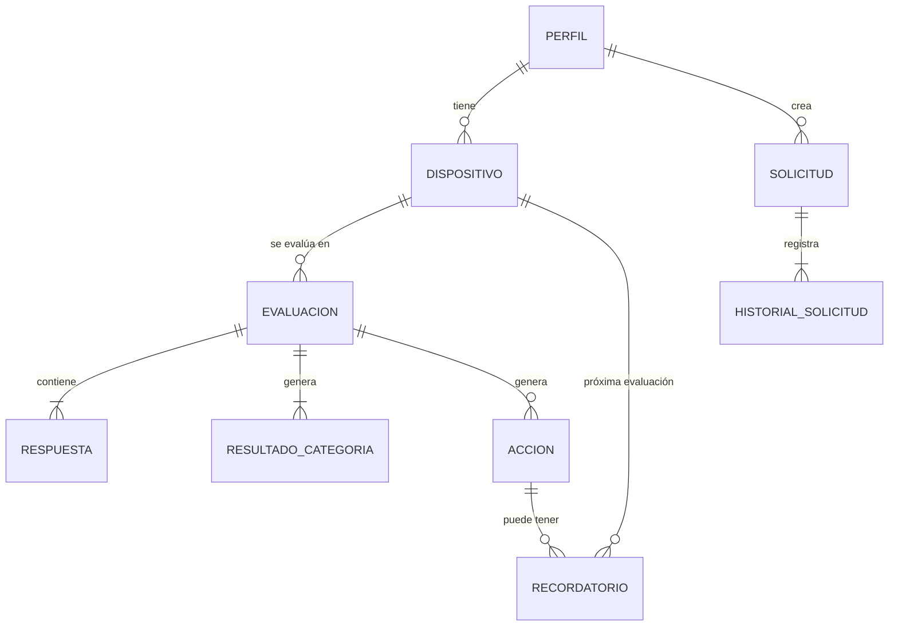

# TT-04 · Modelo local y repositorios MVVM

**Responsable:** Enzo Morales · **Revisión:** Gerard Zambrano
**Alcance:** Evaluación Parcial 2 · app Android con datos locales, sin API.
**Base de diseño:** `docs/TT-03-diseno-navegacion.md` y `docs/TT-03-bocetos.html`, actualizados en TT-27.
**Estado:** propuesta para revisión.

> Todos los datos son ficticios. No se guardan nombres reales, correos, teléfonos, ubicación, contraseñas ni datos sensibles.

### Cambios respecto a la versión anterior (contrato API)

| Se retira de EP2 | Se agrega |
|---|---|
| Endpoints, JSON de red, Retrofit y sincronización remota | Persistencia completa con **Room** (SQLite) |
| Roles de administrador y referente técnico, estados de revisión y versiones de preguntas | Preferencias simples con **DataStore** |
| UUID para evitar duplicados al sincronizar | Imagen opcional del dispositivo (**cámara o galería**) |
| | Regla para eliminar dispositivos sin perder historial |

---

## 1. Dónde se guarda cada dato

| Dato | Dónde | Motivo |
|---|---|---|
| Perfil, dispositivos, evaluaciones, respuestas, resultados, acciones, recordatorios y solicitudes | **Room** | Son registros estructurados, con relaciones y CRUD |
| Categorías, preguntas, recomendaciones y contenidos educativos | **Catálogo fijo en código** (Kotlin) | Son datos de prueba que no edita el usuario. Al vivir en el código no se duplican al reabrir la app (TT-06) |
| Tema, primera ejecución y preferencia de avisos | **DataStore** | Son valores simples clave-valor (TT-08) |
| Imagen del dispositivo | **Archivo en el almacenamiento interno de la app**; en Room solo se guarda su ruta | Room no debe guardar imágenes. Ver sección 6 |

Ninguna pantalla necesita internet. Ningún Composable accede directamente a Room ni a DataStore: siempre pasa por un ViewModel y un repositorio.

---

## 2. Convenciones

| Tema | Regla |
|---|---|
| Identificadores | `Long` autogenerado por Room (`@PrimaryKey(autoGenerate = true)`) |
| Catálogo | IDs de texto estables: `"AUT-01"`, `"REC-AUT-01"`. No cambian entre versiones de la app |
| Fechas | `Long` en milisegundos (`System.currentTimeMillis()`). Se formatean solo al mostrar |
| Enums | Clases `enum` de Kotlin. Room los guarda como texto con su nombre |
| Nombres | Tablas y campos en español y `camelCase`, iguales a los de los bocetos |

---

## 3. Catálogo fijo (código, no Room)

```kotlin
enum class Categoria(val nombre: String) {
    RESPALDOS("Respaldos"),
    ACTUALIZACIONES("Actualizaciones"),
    AUTENTICACION("Autenticación"),
    RECUPERACION("Recuperación de cuentas")
}

enum class ValorRespuesta(val etiqueta: String) { SI("Sí"), NO("No"), NO_SE("No lo sé") }

data class Pregunta(
    val id: String,                     // "AUT-01"
    val categoria: Categoria,
    val texto: String,                  // "¿Tienes activada la verificación en dos pasos?"
    val ayuda: String,                  // explicación breve bajo la pregunta
    val puntajes: Map<ValorRespuesta, Int>, // ej.: SI=0, NO=2, NO_SE=1
    val orden: Int
)

data class Recomendacion(
    val id: String,                     // "REC-AUT-01"
    val preguntaId: String,             // pregunta que la activa
    val valoresQueActivan: Set<ValorRespuesta>, // ej.: NO y NO_SE
    val titulo: String,                 // "Activar verificación en dos pasos"
    val descripcion: String,
    val prioridad: Prioridad,
    val diasParaRevision: Int,          // para la fecha de revisión de la acción
    val contenidoId: String?            // botón "Aprender cómo hacerlo"
)

data class Contenido(
    val id: String,                     // "CON-AUT-01"
    val categoria: Categoria,
    val titulo: String,
    val resumen: String,
    val cuerpo: String
)
```

Los textos y los puntajes concretos se escriben en **TT-06** (datos) y **TT-10** (reglas de riesgo).

---

## 4. Entidades Room



### 4.1 Perfil (ficticio)
```kotlin
enum class ExperienciaDigital { PRINCIPIANTE, INTERMEDIO, AVANZADO }

@Entity(tableName = "perfil")
data class PerfilEntity(
    @PrimaryKey(autoGenerate = true) val id: Long = 0,
    val alias: String,                  // obligatorio, 2 a 30 caracteres
    val experienciaDigital: ExperienciaDigital,
    val creadoEn: Long,
    val actualizadoEn: Long
)
```
La app maneja **un solo perfil**. Si no existe, se guía a crearlo (primer uso).

### 4.2 Dispositivo (de prueba)
```kotlin
enum class SistemaOperativo { ANDROID, IOS, WINDOWS, MACOS, OTRO }

@Entity(
    tableName = "dispositivo",
    foreignKeys = [ForeignKey(PerfilEntity::class, ["id"], ["perfilId"], onDelete = ForeignKey.CASCADE)],
    indices = [Index("perfilId")]
)
data class DispositivoEntity(
    @PrimaryKey(autoGenerate = true) val id: Long = 0,
    val perfilId: Long,
    val nombre: String,                 // obligatorio, 2 a 30 caracteres. Ej.: "Teléfono de prueba"
    val sistemaOperativo: SistemaOperativo,
    val imagenRuta: String?,            // opcional: archivo interno de la foto o imagen elegida
    val archivado: Boolean = false,     // ver regla de eliminación
    val creadoEn: Long,
    val actualizadoEn: Long
)
```

**Regla de eliminación (preserva el historial):**
- Siempre se pide confirmación con `AlertDialog`.
- **Sin evaluaciones:** se borra el registro y su imagen.
- **Con evaluaciones:** se marca `archivado = true`. Deja de aparecer en *Mis dispositivos* y no se puede evaluar, pero su historial se sigue viendo.
- El mensaje de confirmación lo explica: *"Este dispositivo tiene evaluaciones. Se ocultará de tu lista, pero su historial se conservará."*

### 4.3 Evaluación
```kotlin
enum class NivelRiesgo(val etiqueta: String) {
    RIESGO_BAJO("Riesgo bajo"), RIESGO_MEDIO("Riesgo medio"), RIESGO_ALTO("Riesgo alto")
}

@Entity(
    tableName = "evaluacion",
    foreignKeys = [ForeignKey(DispositivoEntity::class, ["id"], ["dispositivoId"], onDelete = ForeignKey.CASCADE)],
    indices = [Index("dispositivoId")]
)
data class EvaluacionEntity(
    @PrimaryKey(autoGenerate = true) val id: Long = 0,
    val dispositivoId: Long,
    val fecha: Long,
    val nivelGlobal: NivelRiesgo       // el peor nivel entre las categorías
)
```
- Se guarda **solo al finalizar**. Si el usuario sale antes, se pide confirmación y no se guarda nada.
- Mientras responde, las respuestas viven en el `UiState` del ViewModel. Por eso se conservan al retroceder entre preguntas.
- Evaluación, respuestas, resultados y acciones se guardan en **una sola transacción** (`@Transaction`). Si falla, no queda nada a medias y la pantalla ofrece *Reintentar* sin perder las respuestas.
- Ver el detalle desde *Historial* solo lee datos: no crea otra evaluación.

### 4.4 Respuesta
```kotlin
@Entity(
    tableName = "respuesta",
    primaryKeys = ["evaluacionId", "preguntaId"],
    foreignKeys = [ForeignKey(EvaluacionEntity::class, ["id"], ["evaluacionId"], onDelete = ForeignKey.CASCADE)]
)
data class RespuestaEntity(
    val evaluacionId: Long,
    val preguntaId: String,             // ID del catálogo
    val categoria: Categoria,
    val textoPregunta: String,          // copia, para que el historial no cambie si se edita el catálogo
    val valor: ValorRespuesta,
    val puntaje: Int
)
```

### 4.5 Resultado por categoría
```kotlin
@Entity(
    tableName = "resultado_categoria",
    primaryKeys = ["evaluacionId", "categoria"],
    foreignKeys = [ForeignKey(EvaluacionEntity::class, ["id"], ["evaluacionId"], onDelete = ForeignKey.CASCADE)]
)
data class ResultadoCategoriaEntity(
    val evaluacionId: Long,
    val categoria: Categoria,
    val puntaje: Int,
    val nivel: NivelRiesgo,
    val explicacion: String             // ej.: "No indicaste tener verificación en dos pasos."
)
```

### 4.6 Acción (checklist)
```kotlin
enum class Prioridad { ALTA, MEDIA, BAJA }
enum class EstadoAccion { PENDIENTE, COMPLETADA }

@Entity(
    tableName = "accion",
    foreignKeys = [ForeignKey(EvaluacionEntity::class, ["id"], ["evaluacionId"], onDelete = ForeignKey.CASCADE)],
    indices = [Index("evaluacionId"), Index(value = ["evaluacionId", "recomendacionId"], unique = true)]
)
data class AccionEntity(
    @PrimaryKey(autoGenerate = true) val id: Long = 0,
    val evaluacionId: Long,
    val recomendacionId: String,        // ID del catálogo; no se repite en la misma evaluación
    val titulo: String,                 // copia de la recomendación
    val descripcion: String,
    val prioridad: Prioridad,
    val estado: EstadoAccion = EstadoAccion.PENDIENTE,
    val fechaRevision: Long,            // fecha + diasParaRevision
    val completadaEn: Long? = null,     // vuelve a null si se marca otra vez como pendiente
    val actualizadoEn: Long
)
```

### 4.7 Recordatorio
```kotlin
enum class TipoRecordatorio { ACCION, PROXIMA_EVALUACION }
enum class EstadoRecordatorio { PROGRAMADO, CANCELADO, ENVIADO }

@Entity(
    tableName = "recordatorio",
    foreignKeys = [
        ForeignKey(AccionEntity::class, ["id"], ["accionId"], onDelete = ForeignKey.CASCADE),
        ForeignKey(DispositivoEntity::class, ["id"], ["dispositivoId"], onDelete = ForeignKey.CASCADE)
    ],
    indices = [Index("accionId"), Index("dispositivoId")]
)
data class RecordatorioEntity(
    @PrimaryKey(autoGenerate = true) val id: Long = 0,
    val tipo: TipoRecordatorio,
    val accionId: Long?,                // obligatorio si tipo = ACCION
    val dispositivoId: Long?,           // obligatorio si tipo = PROXIMA_EVALUACION
    val titulo: String,
    val fechaHora: Long,                // debe ser futura
    val estado: EstadoRecordatorio = EstadoRecordatorio.PROGRAMADO
)
```
La notificación la programa el teléfono en **TT-16**. Al cancelar o modificar un recordatorio, también se cancela o reprograma su aviso.

### 4.8 Solicitud de asistencia (simulada)
```kotlin
enum class EstadoSolicitud { PENDIENTE, EN_REVISION, RESUELTA, CANCELADA }

@Entity(
    tableName = "solicitud",
    foreignKeys = [ForeignKey(PerfilEntity::class, ["id"], ["perfilId"], onDelete = ForeignKey.CASCADE)],
    indices = [Index("perfilId"), Index(value = ["codigo"], unique = true)]
)
data class SolicitudEntity(
    @PrimaryKey(autoGenerate = true) val id: Long = 0,
    val perfilId: Long,
    val codigo: String,                 // "DEMO-001", generado localmente a partir del id
    val categoria: Categoria,
    val estado: EstadoSolicitud = EstadoSolicitud.PENDIENTE,
    val creadaEn: Long
)

@Entity(
    tableName = "historial_solicitud",
    foreignKeys = [ForeignKey(SolicitudEntity::class, ["id"], ["solicitudId"], onDelete = ForeignKey.CASCADE)],
    indices = [Index("solicitudId")]
)
data class HistorialSolicitudEntity(
    @PrimaryKey(autoGenerate = true) val id: Long = 0,
    val solicitudId: Long,
    val estado: EstadoSolicitud,
    val fecha: Long,
    val nota: String                    // ej.: "Solicitud creada (simulación)"
)
```
No hay campo de descripción libre, para evitar que se escriban datos personales. La pantalla muestra el aviso: *"Demostración académica. No envía solicitudes a especialistas reales."*

### 4.9 Base de datos
```kotlin
@Database(
    entities = [
        PerfilEntity::class, DispositivoEntity::class, EvaluacionEntity::class,
        RespuestaEntity::class, ResultadoCategoriaEntity::class, AccionEntity::class,
        RecordatorioEntity::class, SolicitudEntity::class, HistorialSolicitudEntity::class
    ],
    version = 1,
    exportSchema = true
)
abstract class TioTecDatabase : RoomDatabase() { /* un DAO por grupo (sección 5) */ }
```
Si el esquema cambia después de la primera entrega, se sube `version` y se agrega una migración. **No** se usa `fallbackToDestructiveMigration()`, porque borraría los datos de prueba (criterio de TT-07).

---

## 5. DAO y repositorios

Los DAO solo hablan con Room. Los repositorios juntan DAO, catálogo y archivos, y son lo único que usan los ViewModels. Las lecturas devuelven `Flow` para que la pantalla se actualice sola; las escrituras son `suspend` para no bloquear la interfaz.

| Repositorio | Operaciones principales | Usa |
|---|---|---|
| `PerfilRepository` | `observarPerfil(): Flow<PerfilEntity?>` · `guardar(perfil)` | `PerfilDao` |
| `DispositivoRepository` | `observarActivos(): Flow<List<…>>` · `obtener(id)` · `guardar(dispositivo)` · `eliminar(id)` (aplica la regla de 4.2) · `actualizarImagen(id, ruta?)` | `DispositivoDao`, `EvaluacionDao`, `ImagenRepository` |
| `CatalogoRepository` | `categorias()` · `preguntas()` · `recomendacionesPara(respuestas)` · `contenidos(categoria?)` · `contenido(id)` | Catálogo fijo |
| `EvaluacionRepository` | `guardarEvaluacion(dispositivoId, respuestas): Long` (una transacción: calcula resultados, crea acciones) · `observarHistorial(): Flow<List<…>>` · `observarUltima()` · `obtenerDetalle(id)` | `EvaluacionDao`, `AccionDao`, `CatalogoRepository`, reglas de TT-10 |
| `AccionRepository` | `observarPorEstado(estado): Flow<List<…>>` · `contarPendientes(): Flow<Int>` · `cambiarEstado(id, estado)` | `AccionDao` |
| `RecordatorioRepository` | `observarActivos()` · `crear(…)` · `modificar(…)` · `cancelar(id)` | `RecordatorioDao` (+ aviso del sistema en TT-16) |
| `SolicitudRepository` | `observarTodas()` · `crear(categoria)` (genera `DEMO-00X` y su primer registro de historial) · `obtenerConHistorial(id)` · `cambiarEstado(id, estado)` | `SolicitudDao` |
| `PreferenciasRepository` | `preferencias: Flow<Preferencias>` · `setTema(…)` · `marcarPrimeraEjecucionCompleta()` · `setAvisosActivos(…)` | DataStore |
| `ImagenRepository` | `guardarDesdeUri(uri): String` (copia al almacenamiento interno) · `borrar(ruta)` | Archivos de la app |

Consultas clave de los DAO:
- `DispositivoDao`: `SELECT * FROM dispositivo WHERE archivado = 0 ORDER BY nombre`.
- `EvaluacionDao`: historial `ORDER BY fecha DESC`, unido al nombre del dispositivo para mostrar *"15 de octubre · Teléfono de prueba"*.
- `EvaluacionDao.contarPorDispositivo(id)`: decide entre borrar o archivar.
- `AccionDao`: `WHERE estado = :estado ORDER BY prioridad, fechaRevision`.

---

## 6. Imagen del dispositivo (cámara y galería)

- La cámara (TT-18) y la galería (TT-19) entregan un `Uri`. `ImagenRepository` lo **copia** a la carpeta interna de la app y en Room se guarda solo esa ruta. Así la imagen no se pierde si la foto original se borra de la galería.
- Si el usuario **cancela** la cámara o la galería, el formulario y la imagen anterior no cambian.
- Al **reemplazar** o **quitar** la imagen, se borra el archivo anterior.
- Si la cámara no está disponible o se niega el permiso, se puede elegir de la galería o continuar sin imagen. La imagen nunca es obligatoria.

---

## 7. Preferencias (DataStore)

```kotlin
enum class Tema { SISTEMA, CLARO, OSCURO }

data class Preferencias(
    val tema: Tema = Tema.SISTEMA,
    val primeraEjecucion: Boolean = true,  // muestra bienvenida y aviso de datos ficticios
    val avisosActivos: Boolean = true      // preferencia del usuario; el permiso del sistema se revisa aparte
)
```
Se exponen como `Flow<Preferencias>`, el ViewModel las convierte en `StateFlow` y la UI las observa con `collectAsState()`. Sobreviven al cierre de la app (TT-08).

---

## 8. ViewModels y UiState

Cada ViewModel expone un único `StateFlow<…UiState>` y recibe eventos de la pantalla (`onAliasChange`, `onGuardar`, etc.). Las validaciones viven en el ViewModel o en un validador aparte, nunca en el Composable (TT-26).

| ViewModel | UiState (campos principales) |
|---|---|
| `InicioViewModel` | `alias`, `ultimaEvaluacion` (fecha, dispositivo, nivel) o `null`, `accionesPendientes: Int`, `cargando` |
| `PerfilViewModel` | `alias`, `experiencia`, `errorAlias: String?`, `guardando`, `mensaje` (Snackbar) |
| `DispositivosViewModel` | `dispositivos: List`, `vacio`, `dispositivoAEliminar` (para el `AlertDialog`) |
| `DispositivoFormViewModel` | `nombre`, `sistemaOperativo`, `imagenRuta`, `errorNombre`, `errorSistemaOperativo`, `guardando`, `mensaje` |
| `EvaluacionViewModel` | `preguntas`, `indiceActual`, `respuestas: Map<String, ValorRespuesta>`, `progreso: Float`, `puedeAvanzar`, `mostrarConfirmarSalida`, `guardando`, `errorGuardado` |
| `ResultadosViewModel` | `resultados` por categoría, `recomendaciones` ordenadas por prioridad, `nivelGlobal` |
| `AccionesViewModel` | `filtro` (Pendientes / Completadas), `acciones`, `vacio` |
| `HistorialViewModel` | `evaluaciones` (fecha, dispositivo, nivel), `vacio` |
| `AprendeViewModel` | `categoriaSeleccionada`, `contenidos`, `vacio` |
| `RecordatoriosViewModel` | `recordatorios`, formulario (`tipo`, `accionId` o `dispositivoId`, `fecha`, `hora`), errores por campo, `avisosPermitidos` |
| `SolicitudesViewModel` | `solicitudes`, `categoriaNueva`, `errorCategoria`, `detalleSeleccionado` |
| `PreferenciasViewModel` | `tema`, `avisosActivos`, `permisoNotificaciones` |

**Validaciones por formulario** (según los bocetos, sin inventar campos personales):

| Formulario | Reglas |
|---|---|
| Perfil | Alias obligatorio, 2 a 30 caracteres, no solo espacios. Experiencia obligatoria |
| Dispositivo | Nombre obligatorio, 2 a 30 caracteres, no repetido entre activos. Sistema operativo obligatorio. Imagen opcional |
| Evaluación | Cada pregunta necesita una respuesta para avanzar. *Finalizar* solo con todas respondidas |
| Recordatorio | Acción o dispositivo obligatorio según el tipo. Fecha y hora obligatorias y en el futuro |
| Solicitud | Categoría obligatoria |

---

## 9. Estructura de paquetes (coherente con TT-05)

```
cl.duoc.tiotecpreventivo
├── data
│   ├── local
│   │   ├── entity      // entidades de la sección 4
│   │   ├── dao
│   │   └── TioTecDatabase.kt
│   ├── catalogo        // Categoria, Pregunta, Recomendacion, Contenido + datos de TT-06
│   └── preferences     // DataStore
├── repository          // repositorios de la sección 5
├── viewmodel           // ViewModels de la sección 8
└── ui
    ├── screens         // un archivo por pantalla
    ├── components
    └── theme
```

---

## 10. Qué tarea implementa cada parte

| Tarea | Usa de este documento |
|---|---|
| TT-06 | Sección 3 (catálogo y datos ficticios) |
| TT-07 | Secciones 4, 5 y 9 (Room, DAO y repositorios) |
| TT-08 | Sección 7 (DataStore) |
| TT-10 / TT-12 | Puntajes, niveles y `recomendacionesPara` |
| TT-16 | Recordatorio (4.7) |
| TT-18 / TT-19 | Imagen del dispositivo (sección 6) |
| TT-26 | UiState y validaciones (sección 8) |

## 11. Pendiente por confirmar

- [ ] Puntajes por respuesta y umbrales bajo/medio/alto → TT-10.
- [ ] Opciones finales de experiencia digital y sistema operativo.
- [ ] Revisión y aprobación de Gerard Zambrano.